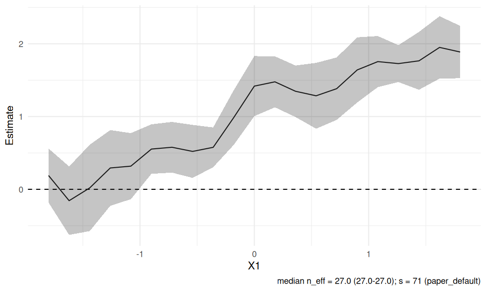

<!-- README.md is generated from README.Rmd. Please edit that file -->

# RdistNN

<!-- badges: start -->

[](https://lifecycle.r-lib.org/articles/stages.html#experimental)
[](https://github.com/JakobJuergens/RdistNN/actions/workflows/R-CMD-check.yaml)
[](https://github.com/JakobJuergens/RdistNN/actions/workflows/test-coverage.yaml)
<!-- badges: end -->

**RdistNN** is an R package for conditional average treatment effects
(CATE) and nonparametric regression using distributional
nearest-neighbor (DNN) weights. It provides local estimates, delete-1
jackknife standard errors, weight and overlap diagnostics, and optional
ggplot2 visualizations.

The initial public release focuses on `cate_dnn()`, `np_dnn()`, and the
DNN weights and tuning tools supporting these workflows. Nuisance
predictions for CATE are supplied by the user. **All PLQR functionality
is experimental**, including its scores, demo data, inference methods,
and plotting helpers. Local IV-GMM is also experimental; advanced
extensions remain available in the reference documentation.

The package accompanies [Orthogonal Inference for Conditional
Z-Estimation without
Cross-Fitting](https://jakobjuergens.com/research/#orthogonal-inference-conditional-z).
See the [documentation](https://JakobJuergens.github.io/RdistNN/) and
[Jakob Juergens’s website](https://jakobjuergens.com/) for project
context.

## Installation

Install release **0.1.0** from GitHub (R 4.1.0 or newer):

``` r
install.packages("pak")  # once
pak::pak("JakobJuergens/RdistNN@v0.1.0")
```

The [v0.1.0
release](https://github.com/JakobJuergens/RdistNN/releases/tag/v0.1.0)
also provides `RdistNN_0.1.0.tar.gz` with built HTML vignettes and a
`SHA256SUMS` file. After installing Rcpp, install that source asset
directly:

``` r
install.packages("Rcpp")  # once
install.packages(
  "https://github.com/JakobJuergens/RdistNN/releases/download/v0.1.0/RdistNN_0.1.0.tar.gz",
  repos = NULL, type = "source"
)
```

For the current development version, use
`pak::pak("JakobJuergens/RdistNN")`.

This installs from source and requires a C++17 toolchain and Rcpp. Use
Rtools matching your R version on Windows, Xcode command line tools on
macOS, or an R-compatible C++ compiler on Linux. OpenMP is optional;
supported kernels run serially when R’s toolchain does not supply OpenMP
flags.

The online guides are available independently of installation. To
include local HTML vignettes, use:

``` r
install.packages("remotes")  # once
remotes::install_github("JakobJuergens/RdistNN", ref = "v0.1.0", build_vignettes = TRUE)
vignette("getting-started", package = "RdistNN")
```

## Conditional average treatment effects

This example uses simulated data and **oracle nuisance values** to show
the interface. For an application, replace these columns with your
estimated conditional outcome means and treatment propensities.

``` r
library(RdistNN)

demo <- cate_demo_data(n = 180, p = 2, design = "hetero", seed = 1)
df <- demo$data
df$m1_oracle <- df$m0_oracle + df$tau_oracle

fit_cate <- cate_dnn(
  data = df, x_cols = c("X1", "X2"),
  y_col = "Y", t_col = "D",
  m0_col = "m0_oracle", m1_col = "m1_oracle", e_col = "e_oracle",
  x0 = c(0, 0), k = 1L, se = TRUE,
  return = c("W", "psi", "nuisance")
)

summary(fit_cate)
#> <summary.cate_result>
#>   targets: 1
#>          estimate std.error statistic p.value conf.low conf.high
#> target_1   0.4527    0.2607     1.737 0.08242 -0.05817    0.9636
confint(fit_cate)
#>             conf.low conf.high
#> target_1 -0.05817257 0.9636003
predict(fit_cate, x0 = c(0.2, -0.1), interval = "confidence")
#>            fit       lwr      upr
#> [1,] 0.7890503 0.4451826 1.132918
```

The matrix interface accepts an externally constructed pseudo-outcome:
`cate_dnn(X = X, x0 = x0, pseudo_outcome = psi)`. The [getting-started
guide](https://JakobJuergens.github.io/RdistNN/articles/getting-started.html)
shows both input formats and how to inspect local overlap.

### CATE inference conditions

Neyman orthogonality controls first-order population nuisance drift.
Valid full-sample nuisance reuse additionally requires the nuisance-rate
and full-state stability conditions in the paper. `cate_dnn()` computes
the estimator and jackknife procedure; it cannot establish those
conditions for an arbitrary learner. Oracle, out-of-fold, and
full-sample predictions can be supplied, but each inferential
interpretation needs the corresponding assumptions, including overlap
and localization bias control.

For nuisance-based AIPW and Robinson scores, supplied propensities must
be finite and lie in `[0, 1]`; they are clipped to `[clip, 1 - clip]`,
with `clip = 1e-8` by default. Clipping does not establish overlap.
Supplied pseudo-outcomes are used unchanged. Reported intervals are
pointwise, and do not provide simultaneous coverage of an entire
covariate profile.

## Nonparametric regression

``` r
demo_np <- np_demo_data(n = 180, p = 2, design = "sinusoidal", seed = 2)
fit_np <- np_dnn(
  data = demo_np$data, x_cols = c("X1", "X2"), y_col = "Y",
  x0 = c(0, 0), k = 1L, se = TRUE, return = c("W", "dx", "ess")
)

fit_np$mu
#> [1] 0.03318309
fit_np$se
#> [1] 0.1328814
diagnostics(fit_np)[, c("target_id", "n_eff", "weighted_mean_y")]
#> <dnn_diagnostics>
#>   targets: 1
#>   n_eff  : min=17.5249, median=17.5249, max=17.5249
#>   dist   : available for 0/1 target(s)
```

For matrices, use `np_dnn(X = X, x0 = x0, Y = y)`. Regression results
expose `mu` and `se` directly; CATE additionally provides `summary()`,
`confint()`, and `predict()` methods. Both workflows support
`diagnostics()`, `plot_data_estimates()`, and optional `plot()` methods.

Two-scale regression is available through `np_tdnn()` with explicit
`s1 < s2` (`s2 < n` for jackknife standard errors). Its signed weights
and additional smoothness requirements are explained in the
getting-started guide and `?np_tdnn`; `plot_tdnn_scales()` compares the
component scales.

## Localization and tuning

With `k = 1` and no explicit `s`, the default is
`s = floor(0.4 * n^((p + 1)/(p + 2)))`. Here `s` is the subsample order:
increasing it concentrates weights closer to the target. Exact DNN
weights average over size-`s` subsamples, using the full rank
permutation, with support through rank `n - s + k`. The optional
`neighbors` extra reports the first `k` neighbors, rather than the full
weight support.

Use `tuning = tuning_dnn_paper()` to specify the paper’s rule, or
`tuning_mode = "grid"` to compare its sensitivity grid
`lambda = c(0.3, 0.4, 0.5, 0.75)`. `candidate_fit()` and `plot_tuning()`
inspect the stored candidates. The manuscript derivations use `k = 1`;
larger fixed `k` values are implementation-supported generalizations.

Delete-1 standard errors require `s < n`. `jackknife = "fast"` uses
cached ranks; `"loo"` recomputes leave-one-out weights. Set `se = FALSE`
to skip uncertainty calculations. Weight ESS and overlap diagnostics
help describe local support; they do not verify the assumptions needed
for inference.

## Visualizing CATE

If ggplot2 is installed, `plot(fit)` displays estimates with pointwise
jackknife confidence bounds. This profile holds the second covariate at
zero and again uses oracle nuisance inputs.

``` r
library(RdistNN)

set.seed(42)
n <- 1000
X <- cbind(X1 = runif(n, -2, 2), X2 = rnorm(n))
e <- plogis(0.4 * X[, "X1"])                    # oracle propensity
tau <- 1 + sin(X[, "X1"])                       # true CATE along X1
m0 <- X[, "X1"] - 0.5 * X[, "X2"]               # oracle control mean
treat <- as.integer(runif(n) < e)
Y <- m0 + treat * tau + rnorm(n, sd = 0.5)

df <- data.frame(X, T = treat, Y = Y, e = e, m0 = m0, m1 = m0 + tau)
X0 <- cbind(X1 = seq(-1.8, 1.8, length.out = 21), X2 = 0)

fit <- cate_dnn(
  data = df, x_cols = c("X1", "X2"), y_col = "Y", t_col = "T",
  e_col = "e", m0_col = "m0", m1_col = "m1",
  X0 = X0, k = 1L, se = TRUE, jackknife = "fast"
)

plot(fit)
```



Use `plot_weights()` for weight concentration, `plot_overlap()` for
local treatment support, and `plot_influence()` for score contributions.
`plot_dashboard()` additionally requires patchwork. The [visualization
guide](https://JakobJuergens.github.io/RdistNN/articles/visualising-fits.html)
shows the available panels and their underlying data extractors.

## Documentation and release scope

| Workflow                 | Entry points                                   | Status in 0.1.0                                                                |
|--------------------------|------------------------------------------------|--------------------------------------------------------------------------------|
| CATE                     | `cate_dnn()`, CATE methods and diagnostics     | Release focus                                                                  |
| Nonparametric regression | `np_dnn()`, `np_tdnn()`, diagnostics and plots | Release focus; TDNN uses signed weights                                        |
| Localization             | DNN weights, distances, tuning                 | Supports the main workflows                                                    |
| CATE replication         | `sim_cate_*`, `summarise_sim_results()`        | Paper-specific tools                                                           |
| PLQR                     | `plqr_dnn()`, PLQR scores, helpers and methods | Experimental; evaluates moments at supplied coefficients, without root solving |
| Local IV-GMM             | `gmm_dnn()`, `sim_iv_*`                        | Experimental companion work                                                    |
| Extensions               | Registries, generalized U-statistic utilities  | Advanced reference material                                                    |

Start with [Getting
started](https://JakobJuergens.github.io/RdistNN/articles/getting-started.html),
then read [notation and
conventions](https://JakobJuergens.github.io/RdistNN/articles/notation-and-conventions.html),
[diagnostics](https://JakobJuergens.github.io/RdistNN/articles/diagnostics-reporting.html),
and
[tuning](https://JakobJuergens.github.io/RdistNN/articles/kernel-order-tuning.html).
The [CATE simulation
guide](https://JakobJuergens.github.io/RdistNN/articles/paper-cate-simulation.html)
covers replication tools; its small illustrative runs are not manuscript
evidence.

With local vignettes installed, open the symbol guide with
`vignette("notation-and-conventions", package = "RdistNN")`.

## Development and help

Report issues with a minimal reproducible example through the [issue
tracker](https://github.com/JakobJuergens/RdistNN/issues). See
[CONTRIBUTING.md](https://github.com/JakobJuergens/RdistNN/blob/master/CONTRIBUTING.md)
for local checks and
[RELEASING.md](https://github.com/JakobJuergens/RdistNN/blob/master/RELEASING.md)
for source packaging and publication instructions. The package is
licensed under GPL version 3 or later.

Supported R algorithmic fallbacks can be selected with
`options(RdistNN.use_compiled = FALSE)`; source installation still
requires a compiler. Cross-platform CI covers Linux, Windows, and both
macOS architectures. Edit `README.Rmd` and regenerate with
`devtools::build_readme()`.
