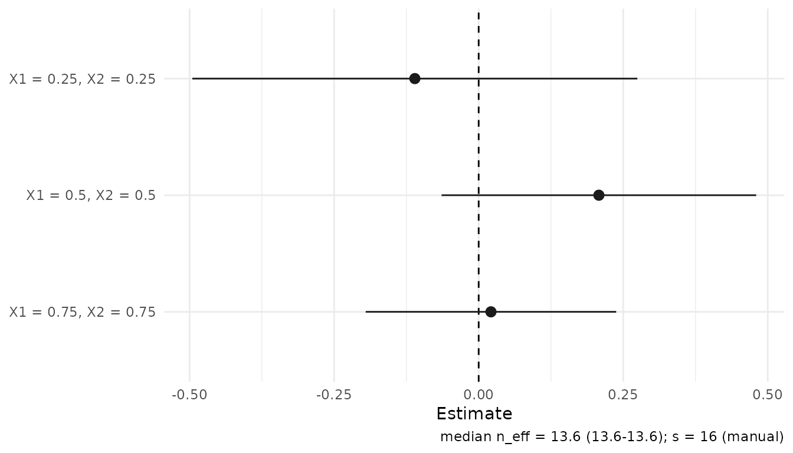
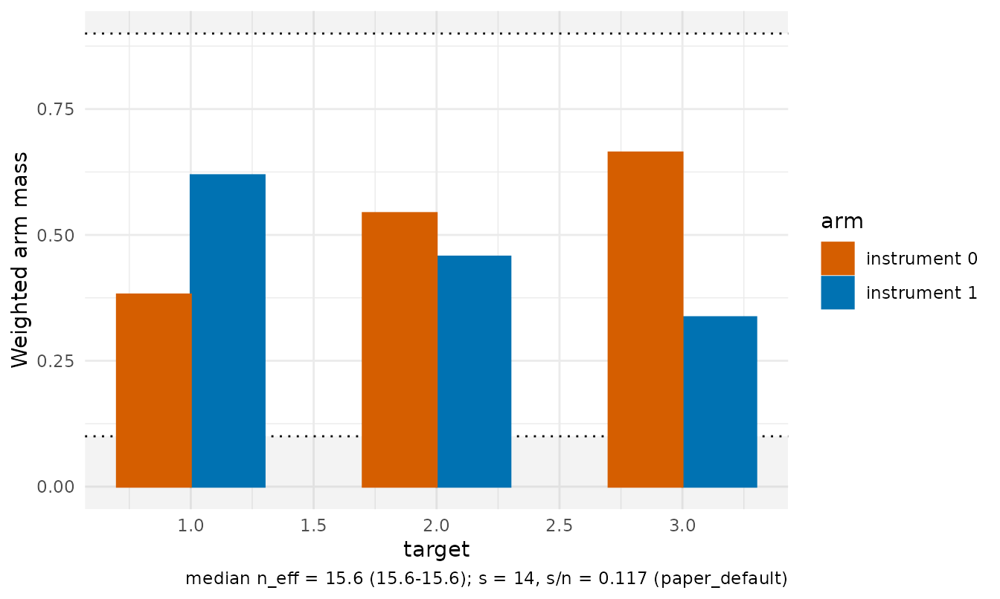

# Conditional LATE from supplied nuisance predictions

[`clate_dnn()`](https://JakobJuergens.github.io/RdistNN/reference/clate_dnn.md)
estimates conditional effects among compliers using a binary instrument
`A`, binary treatment `D` and supplied nuisance predictions. The
[paper](https://jakobjuergens.com/research/#orthogonal-inference-conditional-z)
defines the causal target and identifying assumptions. Reporting
covariates can be a subset of the controls used to obtain the nuisance
predictions.

Exactly identical reporting-covariate rows share their block’s average
weight in both the reduced form and first stage, even when their
outcomes or nuisance predictions differ. Each deletion removes the
actual row and redistributes its remaining block’s `n-1` weight-table
mass over the survivors. This is a ratio of two weighted signal
averages, not an average of individual ratios. The package warns that
the block-averaging modification is outside the paper’s theory. See the
[weight
guide](https://JakobJuergens.github.io/RdistNN/articles/dnn-weights.html#identical-covariate-rows).

## Fit from a data frame

This synthetic example uses **oracle** predictions. The five nuisance
vectors are the instrument propensity and the outcome/treatment means in
each instrument arm. Arm indices refer to the instrument, not treatment.

``` r

demo <- clate_demo_data(n = 120, seed = 20261017, heterogeneous = TRUE)
d <- demo$data
targets <- rbind(c(.25, .25), c(.5, .5), c(.75, .75))
```

``` r

fit <- clate_dnn(
  data = d, x_cols = c("X1", "X2"), X0 = targets,
  y_col = "Y", d_col = "D", a_col = "A", e_col = "e_oracle",
  m_y0_col = "m_y0_oracle", m_y1_col = "m_y1_oracle",
  m_d0_col = "m_d0_oracle", m_d1_col = "m_d1_oracle",
  training = "oracle", row_ids = d$row_id, tuning_mode = "grid",
  return = c("W", "dx")
)
summary(fit)$coefficients
#>             estimate std.error  statistic   p.value    conf.low conf.high
#> target_1 -0.09891197 0.1918865 -0.5154713 0.6062237 -0.47500253 0.2771786
#> target_2  0.20115037 0.1265871  1.5890271 0.1120543 -0.04695583 0.4492566
#> target_3  0.04455010 0.1014209  0.4392594 0.6604736 -0.15423127 0.2433315
```

The default fit is retained while the grid compares alternative orders;
it does not select a preferred candidate. `training` records provenance
and fits no models. In an application, merge external predictions onto
the observations using stable IDs before fitting. IDs supplied to the
estimator cannot detect a prediction vector that was independently
reordered.

For matrix inputs, pass the same vectors directly. Here the order is
held at the fitted default so the two calls can be compared:

``` r

X <- as.matrix(d[c("X1", "X2")])
fit_matrix <- clate_dnn(
  X = X, X0 = targets, Y = d$Y, D = d$D, A = d$A,
  e = d$e_oracle, m_y0 = d$m_y0_oracle, m_y1 = d$m_y1_oracle,
  m_d0 = d$m_d0_oracle, m_d1 = d$m_d1_oracle,
  s = fit$meta$s, se = FALSE
)
data.frame(data_frame = coef(fit), matrix = coef(fit_matrix))
#>           data_frame      matrix
#> target_1 -0.09891197 -0.09891197
#> target_2  0.20115037  0.20115037
#> target_3  0.04455010  0.04455010
```

Tibbles use the data-frame interface. All reporting covariates and
prediction vectors must be finite and aligned. Raw instrument
propensities and treatment predictions must lie in `[0,1]`. Propensities
are clipped with `clip = 1e-8` by default; clipping does not create
overlap.

For a genuinely one-sided design, `one_sided = TRUE` permits omission of
`m_d0`; observed treatment must satisfy `D <= A`. The observed check
cannot establish the structural restriction. See
[`?clate_dnn`](https://JakobJuergens.github.io/RdistNN/reference/clate_dnn.md)
for its input rules.

## Read the first stage alongside the effect

``` r

fit$components
#>        numerator denominator
#> [1,] -0.03687344   0.3727905
#> [2,]  0.10219813   0.5080683
#> [3,]  0.03033088   0.6808264
diagnostic <- as.data.frame(diagnostics(fit))
diagnostic[, c("target_id", "denominator", "denominator_se",
               "ratio_status", "wald_available")]
#>          target_id denominator denominator_se ratio_status wald_available
#> target_1  target_1   0.3727905      0.2335520           ok           TRUE
#> target_2  target_2   0.5080683      0.2577646           ok           TRUE
#> target_3  target_3   0.6808264      0.1880182           ok           TRUE
```

The numerator is the adjusted reduced form and the denominator is the
adjusted first stage. Their paired covariance enters ratio uncertainty.
`vcov(fit)` returns marginal ratio covariance matrices, one per profile;
it does not supply cross-profile covariance. These are estimator-scale
variances and must not be divided by effective sample size again.

An exactly zero first stage leaves the ratio undefined; finite negative
first stages retain a signed ratio. A finite estimate can have
unavailable Wald bounds. Inspect statuses and components before
interpreting the output. Weak local first stages can make Wald intervals
unreliable. The [inference
guide](https://JakobJuergens.github.io/RdistNN/articles/conditional-late-inference.md)
explains these fields, covariance scales and the separate experimental
confidence-set helper.

## Supply two signals directly

If another workflow constructs the augmented signals, localize their
means with
[`affine_ratio_dnn()`](https://JakobJuergens.github.io/RdistNN/reference/affine_ratio_dnn.md).
The package’s signal constructor gives the same inputs explicitly:

``` r

signals <- iv_augmented_signals(
  Y = d$Y, D = d$D, A = d$A, e = d$e_oracle,
  m_y0 = d$m_y0_oracle, m_y1 = d$m_y1_oracle,
  m_d0 = d$m_d0_oracle, m_d1 = d$m_d1_oracle
)
ratio <- affine_ratio_dnn(
  X = X, X0 = targets,
  numerator = signals$phi_y, denominator = signals$phi_d,
  s = fit$meta$s
)
data.frame(clate = coef(fit), paired_signals = coef(ratio))
#>                clate paired_signals
#> target_1 -0.09891197    -0.09891197
#> target_2  0.20115037     0.20115037
#> target_3  0.04455010     0.04455010
```

Both components use common weights. Average the two signals before
dividing; observation-level signal ratios define a different statistic.
Generic paired signals carry no instrument record for overlap plots. Use
the nuisance-based CLATE fit when those diagnostics are needed.

## Plot and reuse the fit

With ggplot2 installed:

``` r

plot(fit, style = "forest")
```



``` r

plot_overlap(fit, type = "mass")
```



Weight/kernel and influence views also use the shared plotting API. Keep
`"W"` for weight panels and `"dx"` for distance-based kernels. See
[Visualising
fits](https://JakobJuergens.github.io/RdistNN/articles/visualising-fits.md)
for plot controls.

Extract one grid candidate or evaluate a new profile using retained
signals:

``` r

candidate <- candidate_fit(fit, 1L)
coef(candidate)
#>    target_1    target_2    target_3 
#> -0.07448888  0.17443055  0.09002873
predict(fit, x0 = c(.6, .4), interval = "confidence")
#>              fit        lwr       upr
#> [1,] -0.09169375 -0.5886832 0.4052957
```

Neither operation refits nuisance learners. Saved fits contain
observation-level numeric values and inherit the data’s sharing
restrictions. [`predict()`](https://rdrr.io/r/stats/predict.html)
relocalizes those frozen signals; it does not predict outcomes for new
people. For order controls, see [Kernel-order
tuning](https://JakobJuergens.github.io/RdistNN/articles/kernel-order-tuning.md).
For result fields, see [Notation and
conventions](https://JakobJuergens.github.io/RdistNN/articles/notation-and-conventions.md).
