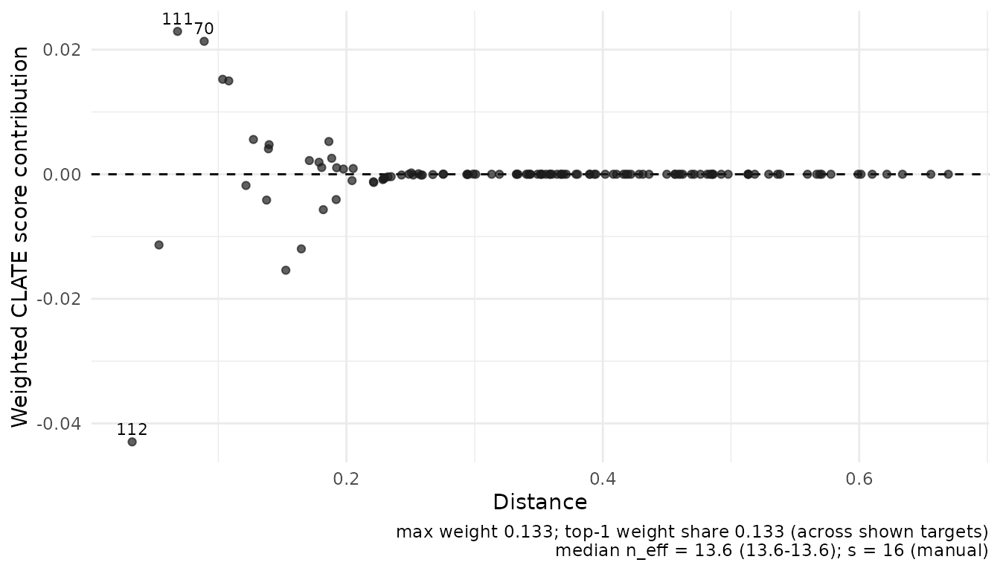
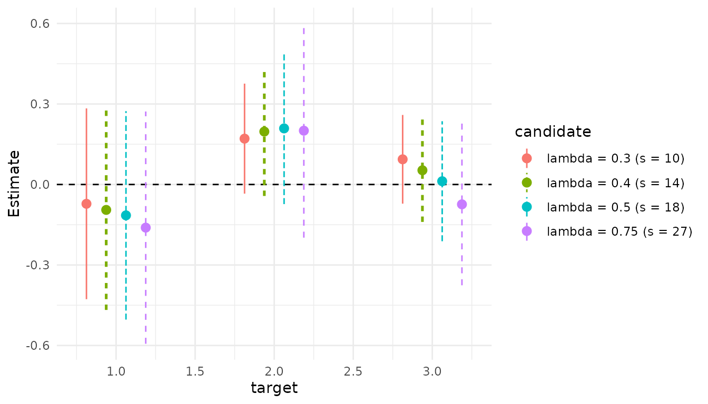
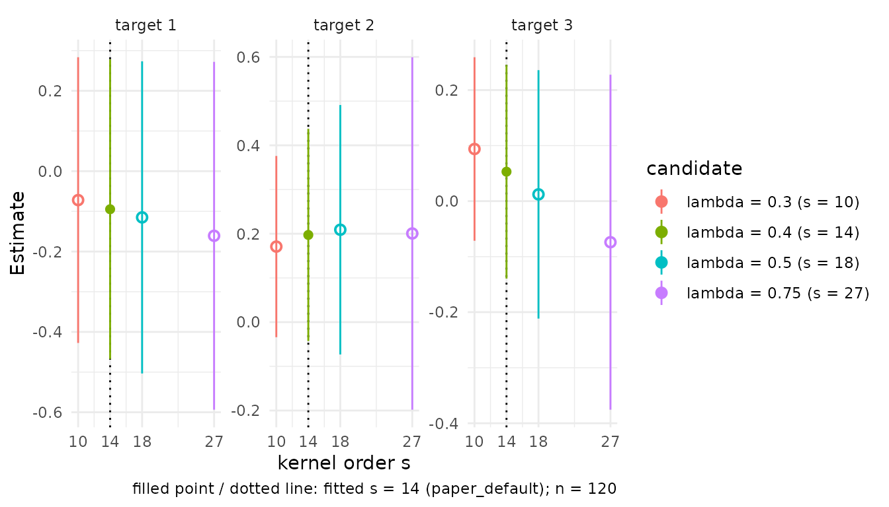

# Conditional LATE from supplied nuisance predictions

[`clate_dnn()`](https://JakobJuergens.github.io/RdistNN/reference/clate_dnn.md)
estimates a conditional local average treatment effect from externally
supplied nuisance predictions. This experimental workflow uses a binary
instrument `A` and binary treatment `D`. For example, an encouragement
may change participation without determining it perfectly. Under the IV
assumptions, the target is the effect among people whose treatment
changes with encouragement, conditional on a reporting profile.

The full adjustment vector $`V=(X,Z)`$ contains the pre-instrument
covariates needed for instrument exogeneity. Reporting uses only $`X`$.
The effect therefore averages over the distribution of the additional
controls $`Z`$ at each reporting profile, with compliance weights. It
generally differs from population CATE.

Causal interpretation requires consistency, exclusion, conditional
instrument independence given $`V`$, monotonicity, instrument overlap
and positive local compliance. Without those causal assumptions, the
calculation estimates a standardized observed-data Wald functional
wherever its denominator is nonzero. Predictions alone do not verify
identification.

## An example with known nuisance functions

[`clate_demo_data()`](https://JakobJuergens.github.io/RdistNN/reference/clate_demo_data.md)
generates a bounded model with endogenous treatment, a conditionally
valid instrument and known nuisance functions. The latent compliance
rank also affects untreated outcomes. Its default data frame contains
observed variables and explicitly labelled oracle prediction columns;
latent variables are available only with `keep_latent = TRUE`.

``` r

demo <- clate_demo_data(n = 120, seed = 20261017, heterogeneous = TRUE)
d <- demo$data
X <- as.matrix(d[c("X1", "X2")])
targets <- rbind(c(.25, .25), c(.5, .5), c(.75, .75))
data.frame(targets,
           CLATE = demo$truth$theta(targets), CATE = demo$truth$cate(targets))
#>     X1   X2      CLATE   CATE
#> 1 0.25 0.25 0.06542969 0.0625
#> 2 0.50 0.50 0.12792969 0.1250
#> 3 0.75 0.75 0.19042969 0.1875
```

With `heterogeneous = TRUE`, CLATE exceeds CATE by $`3/1024`$. The
default model instead has the same treatment effect for everyone at a
given $`X`$, so the targets coincide. Neither model turns a single
draw’s confidence interval into evidence of repeated-sampling coverage.

The five prediction vectors have the following roles:

| Argument       | Function evaluated at each observed $`V_i`$ |
|----------------|---------------------------------------------|
| `e`            | $`P(A=1\mid V)`$, instrument propensity     |
| `m_y0`, `m_y1` | $`E[Y\mid A=0,V]`$, $`E[Y\mid A=1,V]`$      |
| `m_d0`, `m_d1` | $`E[D\mid A=0,V]`$, $`E[D\mid A=1,V]`$      |

Arm indices refer to the instrument. The outcome regressions do not
condition on participation as an extra control. In an application,
supply aligned predictions from the chosen learning procedure. One
full-sample nuisance state can contain five fitted regressions. The
`training` label records their provenance; it does not train or validate
them.

## Matrix inputs and the two augmented signals

``` r

fit <- clate_dnn(
  X = X, X0 = targets, Y = d$Y, D = d$D, A = d$A,
  e = d$e_oracle, m_y0 = d$m_y0_oracle, m_y1 = d$m_y1_oracle,
  m_d0 = d$m_d0_oracle, m_d1 = d$m_d1_oracle,
  s = 16L, training = "oracle", row_ids = d$row_id,
  return = c("W", "dx", "nuisance")
)
```

The wrapper constructs the augmented contrast for each response
$`R=Y,D`$:

``` math
\phi_R=m_{R,1}-m_{R,0}
 +\frac A e(R-m_{R,1})
 -\frac{1-A}{1-e}(R-m_{R,0}).
```

It then solves the affine equation
$`\sum_iw_i(x)(\theta\phi_{D,i}-\phi_{Y,i})=0`$. The result is a ratio
of weighted averages, with common weights for both signals. Do not
average observation-level signal ratios.

The constructor and generic ratio engine are also available separately:

``` r

signals <- iv_augmented_signals(
  Y = d$Y, D = d$D, A = d$A, e = d$e_oracle,
  m_y0 = d$m_y0_oracle, m_y1 = d$m_y1_oracle,
  m_d0 = d$m_d0_oracle, m_d1 = d$m_d1_oracle,
  row_ids = d$row_id, training = "oracle"
)
ratio <- affine_ratio_dnn(
  X = X, X0 = targets, numerator = signals$phi_y, denominator = signals$phi_d,
  s = 16L, row_ids = signals$row_ids
)
stopifnot(isTRUE(all.equal(ratio$theta, fit$theta)),
          isTRUE(all.equal(ratio$theta_vcov, fit$theta_vcov)))
```

Both high-level estimators use the same weighting controls as
[`cate_dnn()`](https://JakobJuergens.github.io/RdistNN/reference/cate_dnn.md)
and
[`np_dnn()`](https://JakobJuergens.github.io/RdistNN/reference/np_dnn.md):
`method = "exact"` or `"asymp"`, `1 <= k <= s`, and `normalize` for
asymptotic weights. Exact DNN and `k = 1L` are the defaults. Supply a
deterministic integer `s`, or an existing tuning specification. Without
either, the package’s paper-default rule resolves the order. Covariance
requires `s < n`. The same order and weight rule are used after every
deletion and retained by
[`predict()`](https://rdrr.io/r/stats/predict.html) and
[`diagnostics()`](https://JakobJuergens.github.io/RdistNN/reference/diagnostics.md).
CATE and CLATE expose single-scale DNN only; the two-scale
[`np_tdnn()`](https://JakobJuergens.github.io/RdistNN/reference/np_tdnn.md)
regression method has no corresponding justification here.

For example, the generic composition can use asymptotic DNN while
retaining the default single neighbor per subsample:

``` r

approximate <- affine_ratio_dnn(
  X = X, X0 = targets, numerator = signals$phi_y, denominator = signals$phi_d,
  s = 16L, method = "asymp", k = 1L, normalize = TRUE
)
summary(approximate)$coefficients
#>             estimate std.error  statistic   p.value    conf.low conf.high
#> target_1 -0.10497893 0.1940726 -0.5409261 0.5885585 -0.48535418 0.2753963
#> target_2  0.20472288 0.1326690  1.5431097 0.1228042 -0.05530365 0.4647494
#> target_3  0.03246375 0.1059318  0.3064590 0.7592552 -0.17515872 0.2400862
```

Availability of a weighting option is a computational contract.
Statistical validity still requires the localization, bias and nuisance
conditions for that choice; it does not extend an exact, single-neighbor
theorem automatically.

## Data frames and tibbles

Select all columns explicitly. Tibbles follow the same data-frame path;
there is no formula interface or implicit column guessing.

``` r

estimate_from_table <- function(data) {
  clate_dnn(
    data = data, x_cols = c("X1", "X2"), X0 = targets,
    y_col = "Y", d_col = "D", a_col = "A", e_col = "e_oracle",
    m_y0_col = "m_y0_oracle", m_y1_col = "m_y1_oracle",
    m_d0_col = "m_d0_oracle", m_d1_col = "m_d1_oracle",
    s = 16L, training = "oracle", row_ids = data$row_id
  )
}
table_fit <- estimate_from_table(d)
stopifnot(isTRUE(all.equal(table_fit$theta, fit$theta)),
          isTRUE(all.equal(table_fit$component_vcov, fit$component_vcov)))
if (requireNamespace("tibble", quietly = TRUE)) {
  tibble_fit <- estimate_from_table(tibble::as_tibble(d))
  stopifnot(isTRUE(all.equal(tibble_fit$theta, fit$theta)))
}
```

Every observation and prediction vector must be finite and aligned in
the same row order. Row IDs must be unique, finite/nonmissing numeric or
nonempty character values. IDs document alignment; the wrapper cannot
detect a separately permuted prediction vector supplied without its own
row map. Align external predictions before passing them.

Instrument propensities must lie in `[0,1]` and are clipped to
`[clip,1-clip]`; the default is `clip = 1e-8`. Raw and used propensities
are retained by the constructor. Treatment predictions must lie in
`[0,1]`; outcome predictions are finite but not automatically capped.
Clipping a propensity does not establish overlap, and clipping
predictions does not bound an unbounded observed outcome.

## Report components with the ratio

``` r

report <- summary(fit)
knitr::kable(report$coefficients, digits = 4, caption = "Conditional ratio and pointwise inference")
```

|          | estimate | std.error | statistic | p.value | conf.low | conf.high |
|:---------|---------:|----------:|----------:|--------:|---------:|----------:|
| target_1 |  -0.1104 |    0.1964 |   -0.5622 |  0.5740 |  -0.4953 |    0.2745 |
| target_2 |   0.2079 |    0.1388 |    1.4976 |  0.1342 |  -0.0642 |    0.4800 |
| target_3 |   0.0212 |    0.1105 |    0.1921 |  0.8477 |  -0.1954 |    0.2379 |

Conditional ratio and pointwise inference {.table}

``` r

knitr::kable(report$components, digits = 4, caption = "Reduced form and first stage")
```

| target_id | numerator | denominator | numerator_se | denominator_se |   neff |
|----------:|----------:|------------:|-------------:|---------------:|-------:|
|         1 |   -0.0431 |      0.3900 |       0.0654 |         0.2493 | 13.621 |
|         2 |    0.1039 |      0.4999 |       0.0974 |         0.2831 | 13.621 |
|         3 |    0.0144 |      0.6780 |       0.0776 |         0.2056 | 13.621 |

Reduced form and first stage {.table style="width:100%;"}

``` r

knitr::kable(report$status, caption = "Computation status by target")
```

| target_id | ratio_status | negative_denominator | near_zero_denominator | covariance_status | wald_available |
|---:|:---|:---|:---|:---|:---|
| 1 | ok | FALSE | FALSE | ok | TRUE |
| 2 | ok | FALSE | FALSE | ok | TRUE |
| 3 | ok | FALSE | FALSE | ok | TRUE |

Computation status by target {.table style="width:100%;"}

For CLATE, the numerator is the adjusted outcome reduced form and the
denominator is the adjusted treatment first stage. `component_vcov`
retains their full paired covariance. `vcov(fit)` returns ratio variance
matrices on the estimator scale; `theta_omega` multiplies those matrices
by `neff`. Do not divide the returned ratio variance by `neff` again.

``` r

info <- as.data.frame(diagnostics(fit))
fields <- c("target_id", "denominator_se", "denominator_stat",
            "instrument_1_mass", "radius_90", "jk_top1_sq_share")
knitr::kable(info[fields], digits = 4, row.names = FALSE,
             col.names = c("Target", "First-stage SE", "First-stage stat.",
                           "Instrument mass", "Radius (90%)", "Largest share"))
```

| Target | First-stage SE | First-stage stat. | Instrument mass | Radius (90%) | Largest share |
|:---|---:|---:|---:|---:|---:|
| target_1 | 0.2493 | 1.5644 | 0.6264 | 0.1954 | 0.2407 |
| target_2 | 0.2831 | 1.7662 | 0.4567 | 0.1807 | 0.5059 |
| target_3 | 0.2056 | 3.2981 | 0.3137 | 0.2115 | 0.3825 |

These diagnostics describe first-stage variation, instrument support,
physical localization and concentration of fitted uncertainty. `neff`
measures reporting-weight concentration, not the number of compliers.
There is no automatic weak-instrument cutoff or target filtering.

## The same plotting workflow as CATE

The fitted object determines the implementation behind each shared call.
[`plot_estimates()`](https://JakobJuergens.github.io/RdistNN/reference/plot_estimates.md),
[`plot()`](https://rdrr.io/r/graphics/plot.default.html) and
[`ggplot2::autoplot()`](https://ggplot2.tidyverse.org/reference/autoplot.html)
use the same profile, forest and pointrange styles as CATE. The
coefficient extractor
[`plot_data_estimates()`](https://JakobJuergens.github.io/RdistNN/reference/plot_data_estimates.md)
returns the common tidy table, while `summary(fit)$coefficients` uses
the same six columns as CATE. Undefined ratios and unavailable Wald
bounds remain visible in the tables.

``` r

if (requireNamespace("ggplot2", quietly = TRUE)) {
  print(plot_estimates(fit, style = "forest"))
  print(plot_overlap(fit, type = "mass"))
  print(plot_influence(fit, targets = 2L))
}
```


    #> Ignoring unknown labels:
    #> • colour : "target"



The remaining common calls are `plot_weights(fit, type = "profile")`,
`type = "cumulative"` or `"kernel"`,
`plot_overlap(fit, type = "propensity")`, and `plot_dashboard(fit)`.
Weight and overlap panels require `W`; the physical-distance weight view
also requires `dx`, so retain both as above. Plots require optional
ggplot2. Dashboards use patchwork when installed and otherwise return a
named list of plots. Unavailable panels are omitted or replaced by
diagnostics using the same policy as CATE.

CLATE overlap panels use **instrument** arms and the instrument
propensity, not treatment uptake. Its influence panel shows the weighted
paired score residual `w * (phi_y - theta * phi_d)`. These are neither
individual causal effects nor jackknife pseudo-values. The latter are
separately available through `return = "pseudo_values"`.

## Tuning sensitivity and candidate views

As for CATE and NP regression, `tuning_mode = "grid"` retains the
default fit and adds common candidate, estimate and diagnostic tables.
All candidates reuse the same signals and frozen ranks. This is a
sensitivity analysis; it does not select an order or justify inference
after data-dependent selection.

``` r

grid_fit <- clate_dnn(
  X = X, X0 = targets, Y = d$Y, D = d$D, A = d$A,
  e = d$e_oracle, m_y0 = d$m_y0_oracle, m_y1 = d$m_y1_oracle,
  m_d0 = d$m_d0_oracle, m_d1 = d$m_d1_oracle,
  tuning_mode = "grid", method = "asymp", training = "oracle",
  return = c("W", "dx")
)
head(grid_fit$tuning_grid$candidates)
#>   candidate_id computed_key is_default feasible reason status lambda  s
#> 1   lambda_0p3         s_10      FALSE     TRUE     ok     ok   0.30 10
#> 2   lambda_0p4         s_14       TRUE     TRUE     ok     ok   0.40 14
#> 3   lambda_0p5         s_18      FALSE     TRUE     ok     ok   0.50 18
#> 4  lambda_0p75         s_27      FALSE     TRUE     ok     ok   0.75 27
views <- candidate_fits(grid_fit)
selected <- candidate_fit(grid_fit, 1L)
summary(selected)$coefficients
#>             estimate  std.error  statistic   p.value    conf.low conf.high
#> target_1 -0.07195888 0.18138100 -0.3967278 0.6915682 -0.42745912 0.2835413
#> target_2  0.17090655 0.10459837  1.6339313 0.1022733 -0.03410249 0.3759156
#> target_3  0.09387875 0.08431531  1.1134247 0.2655261 -0.07137622 0.2591337
```

Candidate views have the same class and reporting methods as a scalar
fit, with paired components and covariance recomputed from cached state.
They retain instrument information for overlap plots and use the
candidate order for prediction. Selecting an infeasible candidate gives
an actionable error. `candidate_fits(fit, ids)` can restrict the list to
feasible candidate IDs.

``` r

if (requireNamespace("ggplot2", quietly = TRUE)) {
  print(plot_estimates(grid_fit, candidates = "all", style = "pointrange"))
  print(plot_tuning(grid_fit))
}
```



`plot_data_estimates(grid_fit, candidates = "all")`, candidate-aware
[`plot_weights()`](https://JakobJuergens.github.io/RdistNN/reference/plot_weights.md)
and
[`diagnostics()`](https://JakobJuergens.github.io/RdistNN/reference/diagnostics.md)
use the same selection grammar as CATE.
[`plot_tuning()`](https://JakobJuergens.github.io/RdistNN/reference/plot_tuning.md)
also works from a scalar fit’s retained state. Stored grid fits reuse
their stored standard errors; refit with `se = TRUE` if these were
omitted and confidence bounds are needed.

## A selected one-sided model

When the design implies $`D(0)=0`$, select `one_sided = TRUE` and omit
`m_d0`, or provide an identically zero vector. The wrapper checks
`D <= A`. That observed check alone does not establish the
counterfactual restriction.

For a simple example, specify perfect compliance, $`D(a)=a`$, and a
constant effect. Here the first-stage signal is identically one and the
estimate and covariance reduce to CATE.

``` r

set.seed(320)
n <- 32L
one_X <- matrix(seq(-1, 1, length.out = n), ncol = 1)
A <- rbinom(n, 1, .5)
baseline <- .2 * one_X[, 1]
Y <- baseline + .5 * A + rnorm(n, sd = .1)
one <- clate_dnn(
  X = one_X, x0 = 0, Y = Y, D = A, A = A, e = rep(.5, n),
  m_y0 = baseline, m_y1 = baseline + .5, m_d1 = rep(1, n),
  one_sided = TRUE, s = 6L, training = "oracle", return = "signals"
)
one$components
#>      numerator denominator
#> [1,] 0.5191015           1
stopifnot(all(one$signals[, 2] == 1))
```

In general one-sided models, an eligible nonparticipant’s augmented
first-stage signal can be negative. The implementation preserves it.

## New reporting profiles

[`predict()`](https://rdrr.io/r/stats/predict.html) changes only the
reporting profiles. It reuses the original observations, frozen signals,
metric and resolved order; it fits no nuisance functions and does not
predict outcomes for new households.

``` r

predict(fit, X0 = rbind(c(.4, .4), c(.6, .6)), se.fit = TRUE)
#> $fit
#> [1] 0.1883769 0.1920315
#> 
#> $se.fit
#> [1] 0.1348139 0.1088746
predict(table_fit, newdata = data.frame(X1 = .5, X2 = .5), interval = "confidence")
#>            fit         lwr       upr
#> [1,] 0.2079148 -0.06418391 0.4800136
```

## Undefined ratios remain visible

An exactly zero aggregate denominator gives an undefined ratio, while
preserving the components and their covariance. This is different from a
finite negative denominator, which remains a computed signed ratio.

``` r

zero <- affine_ratio_dnn(
  X = matrix(1:4), x0 = 0, numerator = c(2, 1, 4, 3),
  denominator = rep(0, 4), s = 2
)
zero$components
#>      numerator denominator
#> [1,]         2           0
zero$status
#>             target_id     ratio_status negative_denominator
#> denominator         1 zero_denominator                FALSE
#>             near_zero_denominator covariance_status wald_available
#> denominator                 FALSE                ok          FALSE
confint(zero)
#>          conf.low conf.high
#> target_1       NA        NA
ratio_confidence_set(zero$components, zero$component_vcov)
#> Paired ratio confidence sets
#>   target 1: unresolved  (coefficient_rounding)
```

For the covariance derivation, exact worked arrays, confidence-set
geometry and pointwise inference conditions, continue with [Paired
frozen-score
inference](https://JakobJuergens.github.io/RdistNN/articles/conditional-late-inference.md).
Full-sample inference needs learner accuracy and deletion stability as
well as orthogonality and undersmoothing. The software’s numerical
statuses do not certify those conditions or causal validity. The
existing [local IV-GMM
workflow](https://JakobJuergens.github.io/RdistNN/articles/local-iv-estimation.md)
uses a different moment and covariance route; it is not an alias for
this augmented CLATE estimator.
