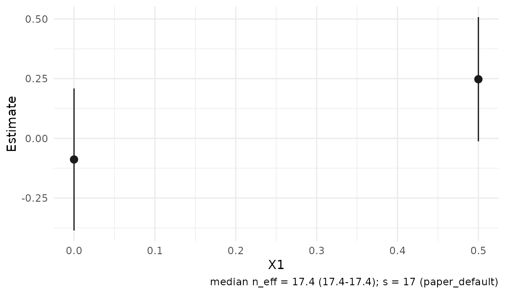
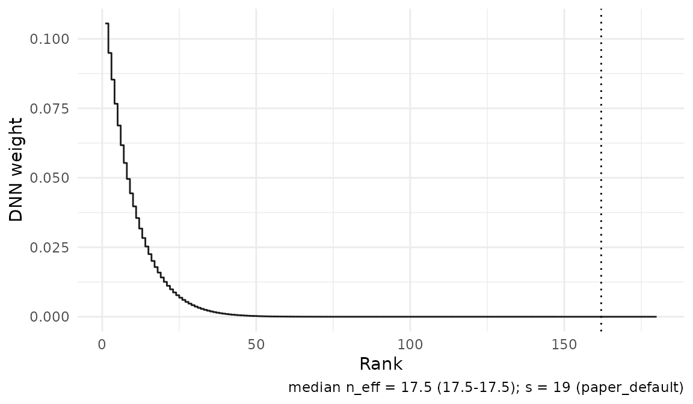

# Getting started: CATE and regression

The initial RdistNN release focuses on conditional average treatment
effects and nonparametric regression with distributional
nearest-neighbor (DNN) weights. Both estimators accept numeric matrices
or data frames, including tibbles through the data-frame interface.
Inputs must be finite and complete; choose covariate columns explicitly
and supply one of `x0` (one target) or `X0` (one target per row).

PLQR and local IV-GMM are experimental. Their reference material is
available for research use, but they are outside the supported workflow
focus of this release. PLQR evaluates moments at supplied coefficients;
it does not solve for target-specific coefficients.

## Conditional average treatment effects

For binary treatment `D`, the AIPW inputs are outcome `Y`, control and
treated conditional means `m0` and `m1`, and propensity `e`. Nuisance
fitting is external to the package. This simulation supplies **oracle
nuisances** so that the example demonstrates localization without
choosing a nuisance learner.

``` r

demo_cate <- cate_demo_data(n = 180, p = 2, design = "hetero", seed = 1)
df <- demo_cate$data
df$m1_oracle <- df$m0_oracle + df$tau_oracle

fit_cate <- cate_dnn(
  data = df, x_cols = c("X1", "X2"), y_col = "Y", t_col = "D",
  m0_col = "m0_oracle", m1_col = "m1_oracle", e_col = "e_oracle",
  x0 = c(0, 0), k = 1L, se = TRUE,
  return = c("W", "psi", "nuisance", "dx")
)

summary(fit_cate)
#> <summary.cate_result>
#>   targets: 1
#>          estimate std.error statistic p.value conf.low conf.high
#> target_1   0.4527    0.2607     1.737 0.08242 -0.05817    0.9636
confint(fit_cate)
#>             conf.low conf.high
#> target_1 -0.05817257 0.9636003
predict(fit_cate, x0 = c(0.2, -0.1), interval = "confidence")
#>            fit       lwr      upr
#> [1,] 0.7890503 0.4451826 1.132918
```

`fit_cate$tau` contains the estimates and `fit_cate$se` contains their
jackknife standard errors.
[`confint()`](https://rdrr.io/r/stats/confint.html) returns pointwise
normal intervals; it does not provide a simultaneous confidence band for
a profile.

If you already have an observation-level pseudo-outcome, pass it
directly. Here we reuse the oracle AIPW scores retained by the preceding
fit:

``` r

X <- as.matrix(df[c("X1", "X2")])
fit_cate_matrix <- cate_dnn(
  X = X, x0 = c(0, 0), pseudo_outcome = fit_cate$psi, k = 1L
)

c(data_frame = fit_cate$tau, matrix = fit_cate_matrix$tau)
#> data_frame     matrix 
#>  0.4527139  0.4527139
```

The data-frame pathway also accepts `pseudo_outcome`, or a Robinson-form
score via `y_col`, `t_col`, `m_col`, and `e_col`. See
[`?cate_dnn`](https://JakobJuergens.github.io/RdistNN/reference/cate_dnn.md)
for the complete input contract. Preserve the same observation order for
every nuisance or pseudo-outcome vector.

### Interpreting CATE inference

Orthogonality controls first-order population nuisance drift. Valid
nuisance reuse on the full estimation sample additionally requires the
nuisance-rate and full-state stability conditions in the accompanying
paper. The package cannot establish those conditions for an arbitrary
learner. Out-of-fold predictions are also accepted, but using them does
not by itself establish all conditions needed for local inference.
Overlap and localization bias control remain necessary.

Raw supplied propensities must lie in `[0, 1]` and are clipped to
`[clip, 1 - clip]` with `clip = 1e-8` by default. Diagnostics use the
clipped values. Clipping does not create local treatment support, and a
supplied pseudo-outcome is used unchanged.

Inspect local weight concentration and treated/control mass:

``` r

d_cate <- diagnostics(fit_cate)
d_cate[, c("target_id", "n_eff", "treated_mass", "control_mass")]
#> <dnn_diagnostics>
#>   targets: 1
#>   n_eff  : min=17.5249, median=17.5249, max=17.5249
#>   dist   : available for 0/1 target(s)
```

Diagnostics describe the realized sample near a target; they are not a
test of the paper’s assumptions. Keep `"W"` in `return` for weight
diagnostics, `"dx"` for distance-radius summaries, and `"nuisance"` for
explicit nuisance inspection. For CATE overlap, the hidden fitted state
retains treatment and propensity inputs when these were supplied.

## Nonparametric regression

[`np_dnn()`](https://JakobJuergens.github.io/RdistNN/reference/np_dnn.md)
estimates a conditional mean by averaging outcomes with DNN weights. Its
result exposes `mu` and `se` directly. The explicit CATE
[`summary()`](https://rdrr.io/r/base/summary.html),
[`confint()`](https://rdrr.io/r/stats/confint.html), and
[`predict()`](https://rdrr.io/r/stats/predict.html) methods do not apply
to `np_result`.

``` r

demo_np <- np_demo_data(n = 160, p = 2, design = "sinusoidal", seed = 2)
fit_np <- np_dnn(
  data = demo_np$data, x_cols = c("X1", "X2"), y_col = "Y",
  X0 = rbind(c(0, 0), c(0.5, 0)), k = 1L, se = TRUE,
  return = c("W", "dx", "ess")
)

# Normal pointwise intervals from the stored jackknife standard errors.
plot_data_estimates(fit_np)[, c("target_id", "estimate", "se", "ci_lower", "ci_upper")]
#>   target_id    estimate        se    ci_lower  ci_upper
#> 1         1 -0.08841632 0.1517981 -0.38593504 0.2091024
#> 2         2  0.24768566 0.1328475 -0.01269067 0.5080620
diagnostics(fit_np)[, c("target_id", "n_eff", "weighted_mean_y")]
#> <dnn_diagnostics>
#>   targets: 2
#>   n_eff  : min=17.3549, median=17.3549, max=17.3549
#>   dist   : available for 0/2 target(s)
```

Use uppercase `Y` for the matrix interface:

``` r

fit_np_matrix <- np_dnn(
  X = as.matrix(demo_np$data[c("X1", "X2")]),
  Y = demo_np$data$Y, x0 = c(0, 0), k = 1L
)
fit_np_matrix$mu
#> [1] -0.08841632
```

To estimate at new regression targets, call
[`np_dnn()`](https://JakobJuergens.github.io/RdistNN/reference/np_dnn.md)
with those targets. The intervals above need the regression assumptions
and localization bias control; the jackknife alone does not remove
smoothing bias.

### Two-scale nonparametric regression

[`np_tdnn()`](https://JakobJuergens.github.io/RdistNN/reference/np_tdnn.md)
provides the existing two-scale DNN regression alternative. Supply
orders `s1 < s2`; delete-1 standard errors additionally require
`s2 < n`. Its weights sum to one but can be negative, so positive-weight
CATE overlap interpretations do not carry over. Its bias-correction
interpretation needs the additional smoothness conditions described in
[`?np_tdnn`](https://JakobJuergens.github.io/RdistNN/reference/np_tdnn.md).

``` r

fit_tdnn <- np_tdnn(
  data = demo_np$data, x_cols = c("X1", "X2"), y_col = "Y",
  x0 = c(0, 0), s1 = 8L, s2 = 16L, se = TRUE
)
c(estimate = fit_tdnn$mu, standard_error = fit_tdnn$se)
#>       estimate standard_error 
#>     -0.2026243      0.1984072
```

The matrix interface uses `X`, `Y`, and `x0`/`X0`, as for
[`np_dnn()`](https://JakobJuergens.github.io/RdistNN/reference/np_dnn.md).
Use
[`plot_tdnn_scales()`](https://JakobJuergens.github.io/RdistNN/reference/plot_tdnn_scales.md)
to compare the two scales when ggplot2 is available. The single-scale
paper tuning rule discussed below applies to
[`np_dnn()`](https://JakobJuergens.github.io/RdistNN/reference/np_dnn.md)
and
[`cate_dnn()`](https://JakobJuergens.github.io/RdistNN/reference/cate_dnn.md);
choose the two TDNN orders explicitly.

## Choosing localization and uncertainty settings

The defaults use exact DNN weights and `k = 1`. Unless `s` or `tuning`
is supplied, the subsample order is
`s = floor(0.4 * n^((p + 1)/(p + 2)))`, where `p` is the covariate
dimension. Larger `s` concentrates more weight near the target. The
written manuscript derivations use `k = 1`; larger fixed `k` is
supported in the implementation.

The order `s` is not a count of observations retained in a
nearest-neighbor truncation. Exact weights use the full rank permutation
and have support through rank `n - s + k` (`n - s + 1` for `k = 1`). The
optional `neighbors` extra reports the first `k` neighbors, rather than
the full weight support.

For sensitivity analysis, compare the paper’s candidate orders without
changing the primary result:

``` r

fit_grid <- np_dnn(
  data = demo_np$data, x_cols = c("X1", "X2"), y_col = "Y",
  x0 = c(0, 0), tuning_mode = "grid", se = FALSE
)
fit_grid$tuning_grid$candidates
#>   candidate_id computed_key is_default feasible reason status lambda  s
#> 1   lambda_0p3         s_13      FALSE     TRUE     ok     ok   0.30 13
#> 2   lambda_0p4         s_17       TRUE     TRUE     ok     ok   0.40 17
#> 3   lambda_0p5         s_22      FALSE     TRUE     ok     ok   0.50 22
#> 4  lambda_0p75         s_33      FALSE     TRUE     ok     ok   0.75 33
candidate_fit(fit_grid, 1L)$mu
#> [1] -0.0286826
```

[`tuning_dnn_paper()`](https://JakobJuergens.github.io/RdistNN/reference/tuning_dnn_paper.md)
uses `lambda = 0.4` and the grid `c(0.3, 0.4, 0.5, 0.75)`; `s` is
recomputed for each candidate. Grid mode is a sensitivity comparison,
not an automatic optimization rule. It cannot be combined with explicit
`s`.

For uncertainty, `jackknife = "fast"` reuses full-sample ranks;
`jackknife = "loo"` directly recomputes leave-one-out weights. Delete-1
inference requires `s < n`. Set `se = FALSE` to omit standard errors.

## Plots and reusable weights

Plotting is optional and requires ggplot2. Dashboards additionally
require patchwork. Both fitted workflows support the estimate and weight
views:

``` r

plot(fit_np)
```



``` r

plot_weights(fit_cate, type = "profile")
```



For your own scalar signal, build weights directly. Rows of `W` index
observations and columns index target points:

``` r

wt <- weights_dnn(
  X = X, X0 = rbind(c(0, 0), c(0.5, 0)), k = 1L, s = 12L,
  return = "W"
)
dim(wt$W)
#> [1] 180   2
as.vector(crossprod(wt$W, fit_cate$psi))
#> [1] 0.562277 1.169279
```

## Further reading

- [Notation and
  conventions](https://JakobJuergens.github.io/RdistNN/articles/notation-and-conventions.md):
  arguments, paper symbols, and uncertainty scales. Open locally with
  [`vignette("notation-and-conventions", package = "RdistNN")`](https://JakobJuergens.github.io/RdistNN/articles/notation-and-conventions.md).
- [Diagnostics and
  reporting](https://JakobJuergens.github.io/RdistNN/articles/diagnostics-reporting.md):
  available fields and retained-state requirements.
- [Kernel-order
  tuning](https://JakobJuergens.github.io/RdistNN/articles/kernel-order-tuning.md)
  and [DNN
  weights](https://JakobJuergens.github.io/RdistNN/articles/dnn-weights.md):
  localization rules and sensitivity choices.
- [Visualizing fitted
  estimators](https://JakobJuergens.github.io/RdistNN/articles/visualising-fits.md):
  CATE profiles, overlap, influence, and dashboards.
- [CATE simulation
  tools](https://JakobJuergens.github.io/RdistNN/articles/paper-cate-simulation.md):
  paper-specific replication workflows; illustrative runs do not
  constitute manuscript evidence.
- [Conditional
  Z-estimation](https://JakobJuergens.github.io/RdistNN/articles/conditional-z-estimation.md):
  additional moment details, including experimental PLQR.
- [Extending
  RdistNN](https://JakobJuergens.github.io/RdistNN/articles/extending.md):
  custom distances, rank weights, and scores.
