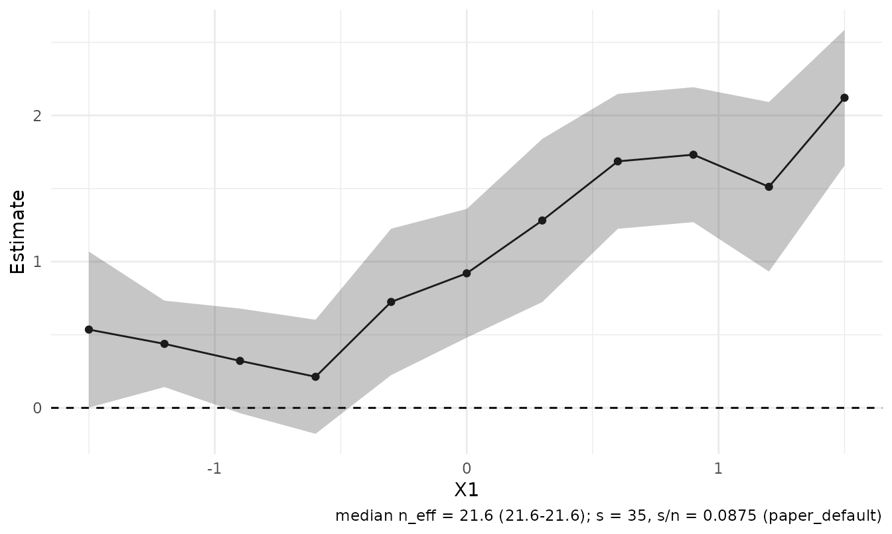
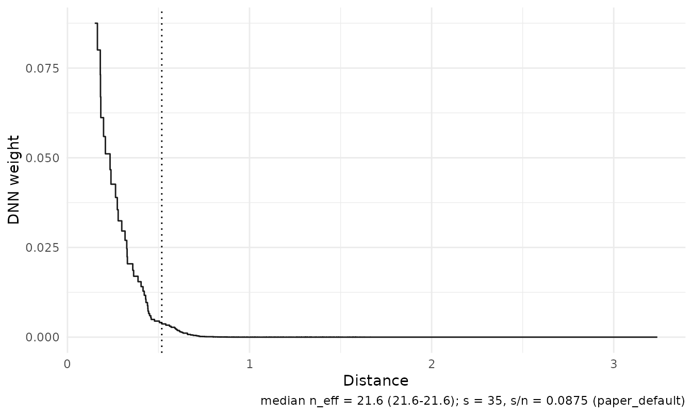
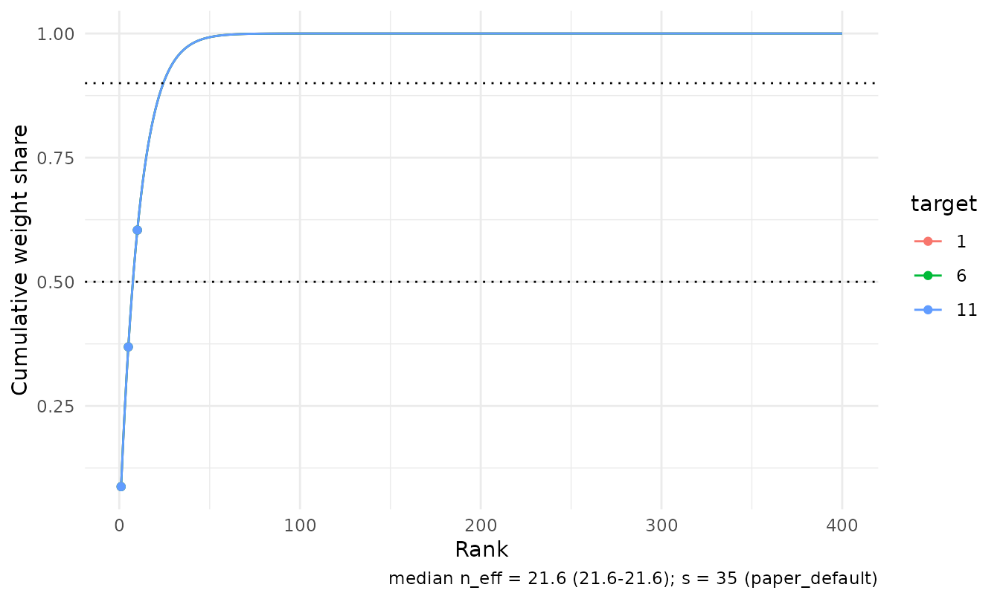
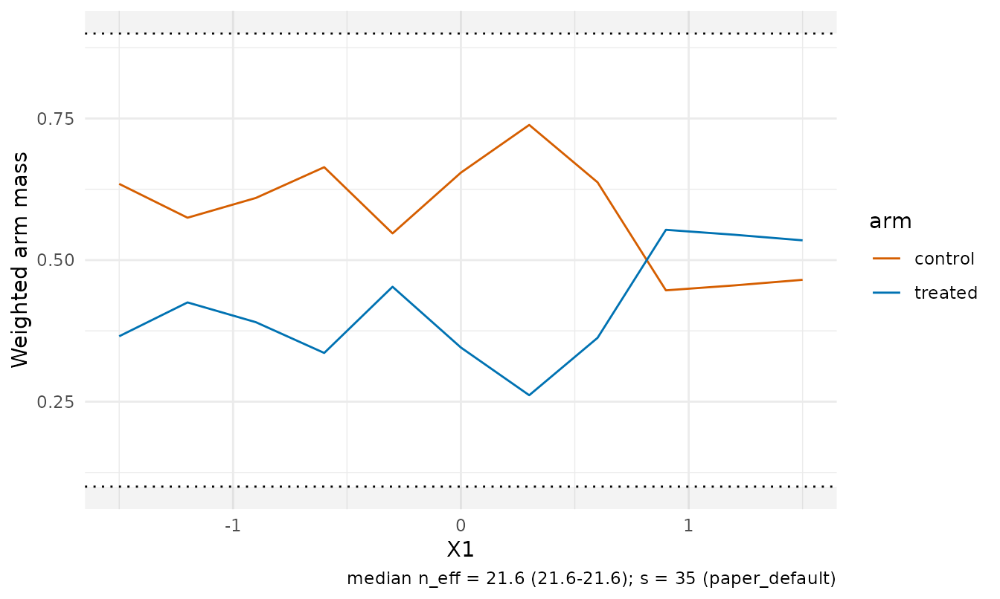
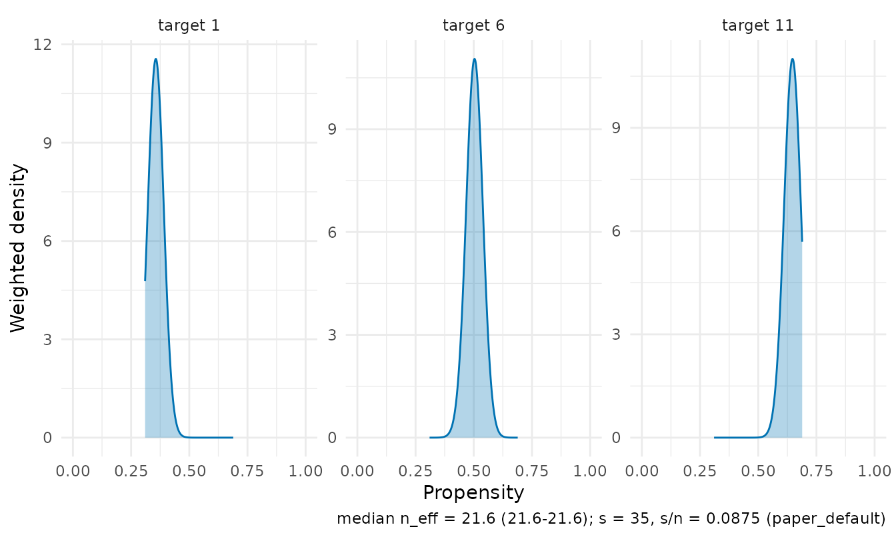
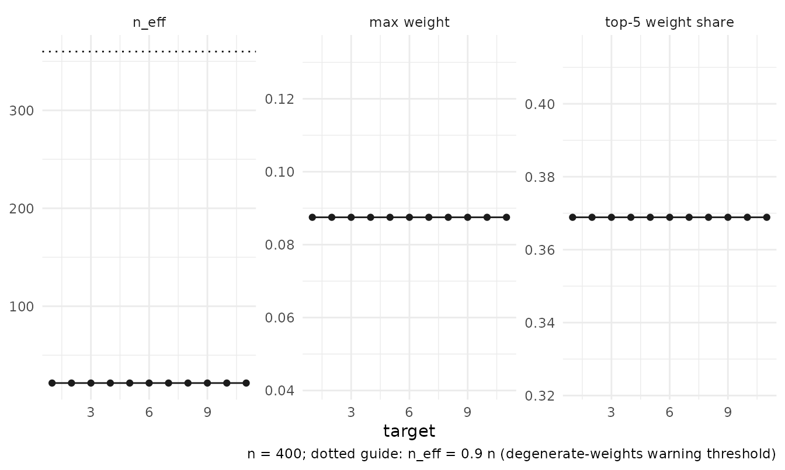
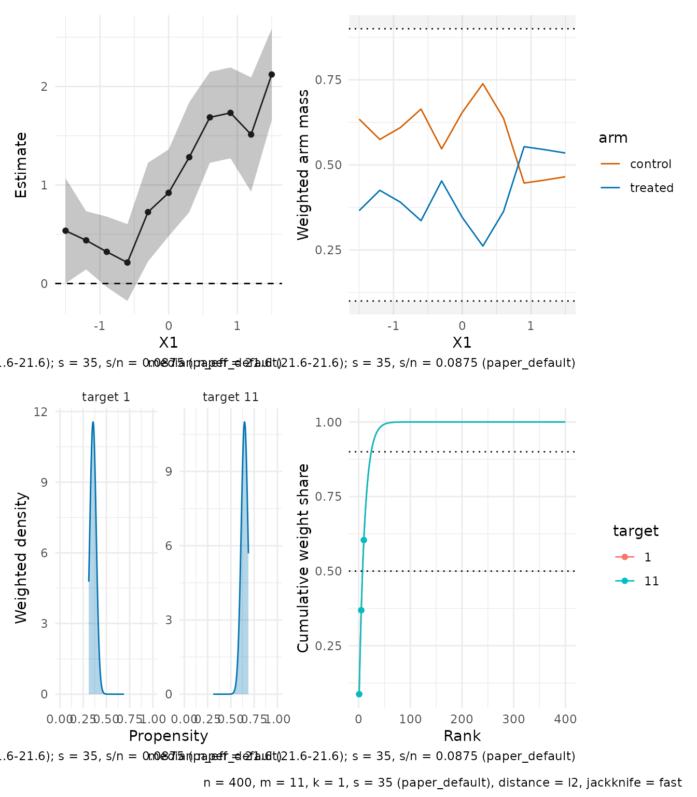
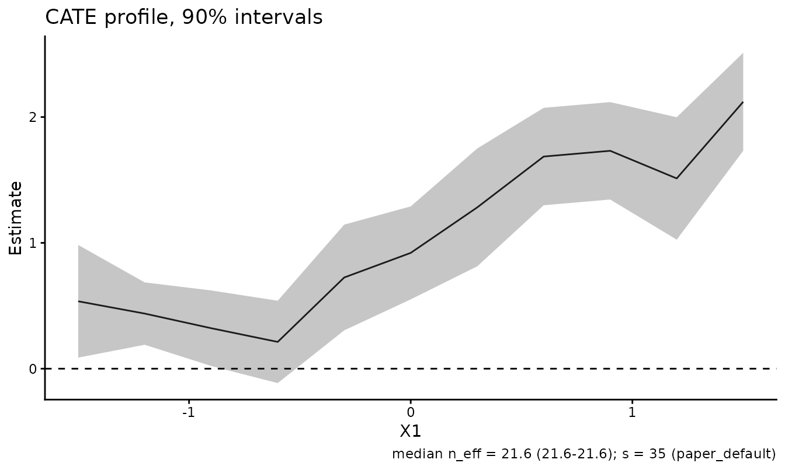

# Visualising fitted local estimators

RdistNN’s plotting functions return ggplot objects that can be extended
with `+`. The examples below run when ggplot2 is installed; the composed
dashboard also uses patchwork.

The running example is a CATE fit with oracle nuisance columns,
evaluated along a profile in the first covariate.

``` r

library(RdistNN)

set.seed(42)
n <- 400
X <- cbind(X1 = runif(n, -2, 2), X2 = rnorm(n))
e <- plogis(0.4 * X[, "X1"])
tau <- 1 + sin(X[, "X1"])
m0 <- X[, "X1"] - 0.5 * X[, "X2"]
treat <- as.integer(runif(n) < e)
Y <- m0 + treat * tau + rnorm(n, sd = 0.5)

df <- data.frame(X, T = treat, Y = Y, e = e, m0 = m0, m1 = m0 + tau)
X0 <- cbind(X1 = seq(-1.5, 1.5, length.out = 11), X2 = 0)

fit <- cate_dnn(
  data = df, x_cols = c("X1", "X2"), y_col = "Y", t_col = "T",
  e_col = "e", m0_col = "m0", m1_col = "m1",
  X0 = X0, k = 1L, se = TRUE, jackknife = "fast",
  return = c("W", "dx")
)
```

## The estimate panel

[`plot()`](https://rdrr.io/r/graphics/plot.default.html) (equivalently
[`ggplot2::autoplot()`](https://ggplot2.tidyverse.org/reference/autoplot.html),
or
[`plot_estimates()`](https://JakobJuergens.github.io/RdistNN/reference/plot_estimates.md)
with more options) draws the profile with pointwise jackknife confidence
bounds, a zero reference line, and a caption reporting the median
effective sample size across targets and the kernel order `s` with its
provenance — here the default paper rule, since neither `s` nor `tuning`
was supplied.

``` r

plot(fit)
```



Small non-profile target sets render as a forest layout with labels
built from the stored coordinates, and `style =`/`x_var =` override the
automatic choices.

## Weight geometry

The weight panels show what the estimator averaged over. The effective
kernel view plots weight against distance, with the rank-`s` radius
marked as a scale diagnostic. That marker is not the DNN support radius.

``` r

plot_weights(fit, type = "kernel", targets = 6L)
```



``` r

plot_weights(fit, type = "cumulative", targets = c(1L, 6L, 11L))
```



## Overlap diagnostics

For CATE fits,
[`plot_overlap()`](https://JakobJuergens.github.io/RdistNN/reference/plot_overlap.md)
shows whether both treatment arms carry weight near each target. With
simplex weights the treated and control masses partition one, so the
treated mass is the local treated share; shaded bands mark shares
outside `share_limits`. These visual guides are not calibrated tests of
overlap.

``` r

plot_overlap(fit, type = "mass")
```



The propensity view draws the weighted propensity distribution at
selected targets when observation-level propensities are available (as
here, through `e_col`), and a weighted q10–q90 summary otherwise.

``` r

plot_overlap(fit, type = "propensity", targets = c(1L, 6L, 11L))
```



## Weight diagnostics facets

`autoplot()` on a
[`diagnostics()`](https://JakobJuergens.github.io/RdistNN/reference/diagnostics.md)
frame tracks the effective sample size (with the degenerate-weights
guide at `0.9 n`), the maximum weight, and the top-5 weight share across
targets.

``` r

ggplot2::autoplot(diagnostics(fit))
```



## The dashboard

[`plot_dashboard()`](https://JakobJuergens.github.io/RdistNN/reference/plot_dashboard.md)
composes the panels with a metadata annotation. It requires patchwork;
without it the panels are returned as a named list. Unavailable panels
are substituted or omitted. For example, a supplied-signal CATE fit
without treatment inputs gets diagnostics in place of overlap.

``` r

plot_dashboard(fit)
```



## Customising panels

Every builder returns a plain ggplot object; add layers, scales, or a
different theme as usual.

``` r

plot_estimates(fit, level = 0.9) +
  ggplot2::labs(title = "CATE profile, 90% intervals") +
  ggplot2::theme_classic(base_size = 11)
```



For fully custom figures, the tidy frames behind the panels are
exported:
[`plot_data_estimates()`](https://JakobJuergens.github.io/RdistNN/reference/plot_data_estimates.md),
[`plot_data_weights()`](https://JakobJuergens.github.io/RdistNN/reference/plot_data_weights.md),
and
[`plot_data_diagnostics()`](https://JakobJuergens.github.io/RdistNN/reference/plot_data_diagnostics.md).

## Related Articles

- [Notation and
  conventions](https://JakobJuergens.github.io/RdistNN/articles/notation-and-conventions.md):
  fields and uncertainty scales.
- [Diagnostics and
  reporting](https://JakobJuergens.github.io/RdistNN/articles/diagnostics-reporting.md):
  diagnostic inputs and availability.
- [Getting
  started](https://JakobJuergens.github.io/RdistNN/articles/getting-started.md):
  first CATE and regression fits.
